# CP5 - API de Clientes e Pedidos

API RESTful desenvolvida em **C# / .NET 10** com **Entity Framework Core**, aplicando os conceitos de REST, versionamento de endpoints, Code-First com Migrations e boas práticas de organização de código.

## Integrantes do grupo

- Léo Masago — RM557768
- Luiz Henrique Silva — RM555235
- Eduardo Tomazela — RM556807

## Contexto do projeto

O projeto simula um sistema simples de **gerenciamento de clientes e pedidos** para uma pequena loja/e-commerce. Ele resolve o problema de manter um cadastro centralizado de clientes e registrar os pedidos feitos por cada um, permitindo consultar, criar, atualizar e excluir tanto clientes quanto pedidos através de uma API HTTP.

É destinado a times de desenvolvimento (back-office, frontend, app mobile) que precisem de um serviço de backend para consumir esses dados via requisições REST — por exemplo, um painel administrativo que lista clientes e o histórico de pedidos de cada um.

Principais entidades:

- **Cliente**: pessoa cadastrada na loja (nome, e-mail, telefone, data de cadastro).
- **Pedido**: uma compra feita por um cliente (descrição, valor, status, data do pedido). Cada pedido pertence a um único cliente (relação 1:N entre `Cliente` e `Pedido`).

## Banco de dados utilizado

**Oracle Database** (mesmo banco utilizado no repositório de exemplo `EFCoreOracle`, hospedado em `oracle.fiap.com.br`), acessado via o provedor `Oracle.EntityFrameworkCore`.

> A string de conexão **não** deve ser commitada com senha real. Veja abaixo como configurá-la localmente.

## Stack utilizada

- .NET 10 / ASP.NET Core Web API (Controllers)
- Entity Framework Core 10 (Code-First + Migrations)
- Oracle.EntityFrameworkCore (provedor Oracle para EF Core)
- Swashbuckle (Swagger / OpenAPI) para documentação e testes interativos

## Estrutura do projeto

```
cp5/
├── Controllers/        # Endpoints da API (ClientesController, PedidosController)
├── Data/                # AppDbContext (EF Core)
├── DTOs/                # Objetos de request/response (evitam expor as entidades diretamente)
├── Models/              # Entidades mapeadas (Cliente, Pedido, StatusPedido)
├── Migrations/          # Migrations do EF Core (histórico do schema do banco)
├── Program.cs           # Configuração da aplicação (DI, Swagger, pipeline HTTP)
├── appsettings.json     # Configurações e connection string (com placeholder de senha)
└── Cp5Api.csproj
```

## Instruções para rodar o projeto localmente

### 1. Pré-requisitos

- [.NET 10 SDK](https://dotnet.microsoft.com/download)
- Acesso a um banco Oracle (ex: `oracle.fiap.com.br:1521/ORCL`) com usuário e senha válidos

### 2. Clonar o repositório

```bash
git clone https://github.com/<seu-usuario>/cp5.git
cd cp5
```

### 3. Configurar a connection string (sem expor sua senha no Git)

Recomendado — usar o **User Secrets** do .NET, que mantém a senha fora do repositório:

```bash
dotnet user-secrets init
dotnet user-secrets set "ConnectionStrings:OracleConnection" "User Id=SEU_RM;Password=SUA_SENHA;Data Source=oracle.fiap.com.br:1521/ORCL;"
```

Alternativa mais simples (apenas para uso local): editar diretamente o valor `ConnectionStrings:OracleConnection` em `appsettings.json`, substituindo `SUA_SENHA_AQUI` pela sua senha real — porém **não faça commit** dessa alteração.

### 4. Restaurar pacotes e aplicar as Migrations

```bash
dotnet restore
dotnet tool install --global dotnet-ef   # caso ainda não tenha a ferramenta
dotnet ef database update
```

Isso cria as tabelas `TB_CP5_CLIENTE` e `TB_CP5_PEDIDO` no banco Oracle configurado.

### 5. Executar a aplicação

```bash
dotnet run
```

A API sobe (por padrão) em `http://localhost:5263`. Acesse a documentação interativa do Swagger em:

```
http://localhost:5263/swagger
```

Pelo Swagger é possível testar todos os endpoints diretamente pelo navegador ("Try it out"). Também é possível importar as rotas no Postman/Insomnia usando o JSON do OpenAPI disponível em `http://localhost:5263/swagger/v1/swagger.json`.

## Endpoints disponíveis

Todas as rotas são versionadas sob o prefixo `/api/v1/`.

### Clientes

| Método | Rota                          | Descrição                                             | Sucesso | Erros comuns |
|--------|-------------------------------|--------------------------------------------------------|---------|--------------|
| GET    | `/api/v1/clientes`            | Lista todos os clientes                                | 200     | —            |
| GET    | `/api/v1/clientes/{id}`       | Busca um cliente pelo id                                | 200     | 404          |
| GET    | `/api/v1/clientes/{id}/pedidos` | Lista os pedidos de um cliente específico             | 200     | 404          |
| POST   | `/api/v1/clientes`            | Cadastra um novo cliente                                | 201     | 400          |
| PUT    | `/api/v1/clientes/{id}`       | Atualiza um cliente existente                           | 204     | 400, 404     |
| DELETE | `/api/v1/clientes/{id}`       | Remove um cliente (e seus pedidos, em cascata)          | 204     | 404          |

Exemplo de corpo (POST/PUT `/api/v1/clientes`):

```json
{
  "nome": "Ana Souza",
  "email": "ana@example.com",
  "telefone": "11999999999"
}
```

### Pedidos

| Método | Rota                                | Descrição                                              | Sucesso | Erros comuns |
|--------|-------------------------------------|---------------------------------------------------------|---------|--------------|
| GET    | `/api/v1/pedidos`                   | Lista todos os pedidos (filtro opcional `?status=`)      | 200     | —            |
| GET    | `/api/v1/pedidos/{id}`              | Busca um pedido pelo id                                  | 200     | 404          |
| POST   | `/api/v1/pedidos`                   | Cria um novo pedido para um cliente existente            | 201     | 400          |
| PUT    | `/api/v1/pedidos/{id}`              | Atualiza um pedido existente                             | 204     | 400, 404     |
| DELETE | `/api/v1/pedidos/{id}`              | Remove um pedido                                         | 204     | 404          |

Exemplo de corpo (POST/PUT `/api/v1/pedidos`):

```json
{
  "clienteId": 1,
  "descricao": "Notebook Gamer",
  "valor": 4500.90,
  "status": "Pendente"
}
```

Status possíveis para `status`: `Pendente`, `Processando`, `Enviado`, `Entregue`, `Cancelado`.

## Migration documentada

A migration inicial `InitialCreate` (pasta `Migrations/`) cria as tabelas `TB_CP5_CLIENTE` e `TB_CP5_PEDIDO` (prefixo `CP5` para não colidir com tabelas de mesmo nome de outros projetos no mesmo schema Oracle, como o `EFCoreOracle`), o relacionamento (chave estrangeira `ID_CLIENTE` com `ON DELETE CASCADE`) e o índice único de e-mail em `TB_CP5_CLIENTE`. Para gerar uma nova migration após alterar as entidades:

```bash
dotnet ef migrations add NomeDaMigration
dotnet ef database update
```

## Boas práticas aplicadas

- DTOs de request/response separados das entidades (evita overposting e ciclos de serialização)
- Validação de dados via Data Annotations (`[Required]`, `[EmailAddress]`, `[MaxLength]`, `[Range]`) retornando `400` com mensagens claras
- Tratamento de erros centralizado (`AddProblemDetails` / `UseExceptionHandler`) — respostas de erro em formato padronizado, sem stack trace exposto
- Regras de negócio validadas na API (e-mail duplicado, `ClienteId` inexistente) antes de tocar o banco
- Connection string fora do código-fonte (via `appsettings.json` configurável e suporte a `dotnet user-secrets`), evitando vazar credenciais no Git

## Prints de evidência dos testes

Testes realizados via Swagger UI (`/swagger`), com o banco Oracle real do grupo. Todos os prints estão na pasta [`prints/`](prints/).

### Clientes

| Endpoint | Print |
|---|---|
| `POST /api/v1/clientes` → **201 Created** | 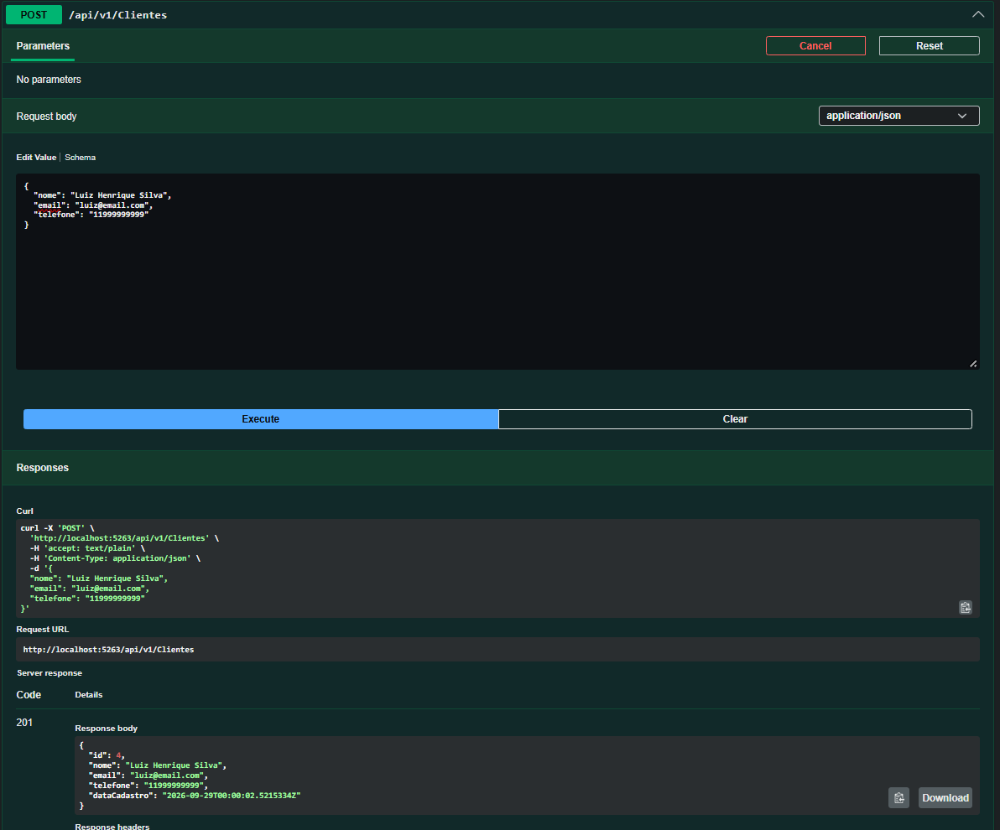 |
| `POST /api/v1/clientes` com e-mail já cadastrado → **400 Bad Request** | 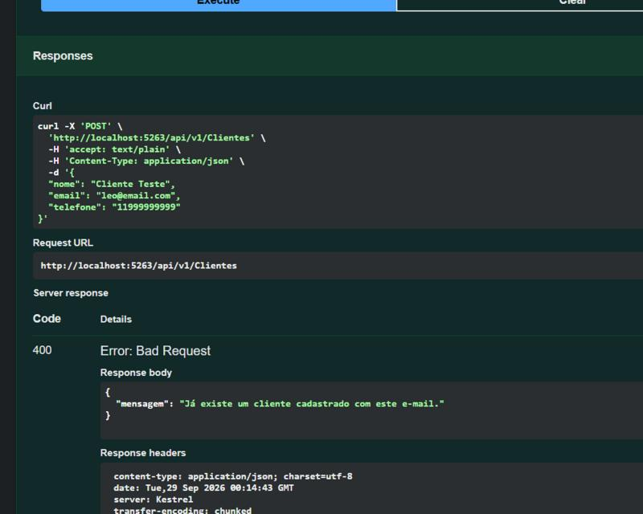 |
| `GET /api/v1/clientes` → **200 OK** (lista todos os clientes cadastrados) | 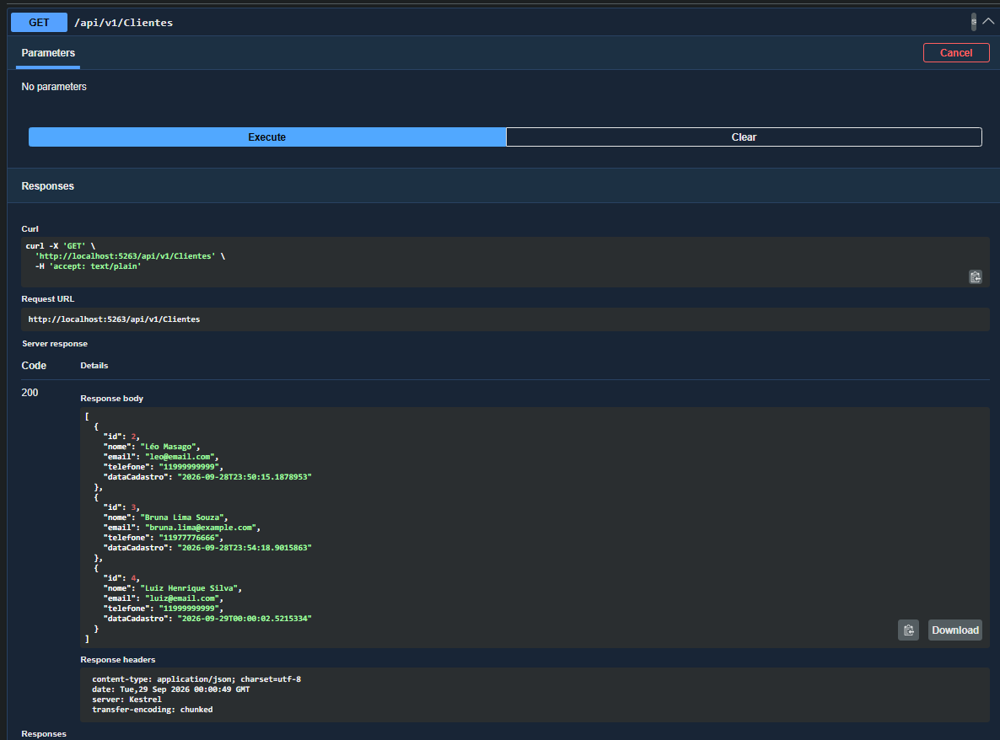 |
| `GET /api/v1/clientes/{id}` → **200 OK** | 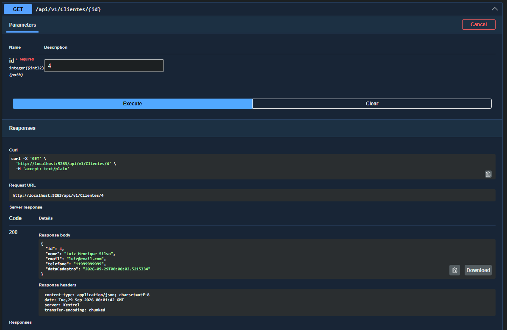 |
| `GET /api/v1/clientes/{id}` com id inexistente → **404 Not Found** | 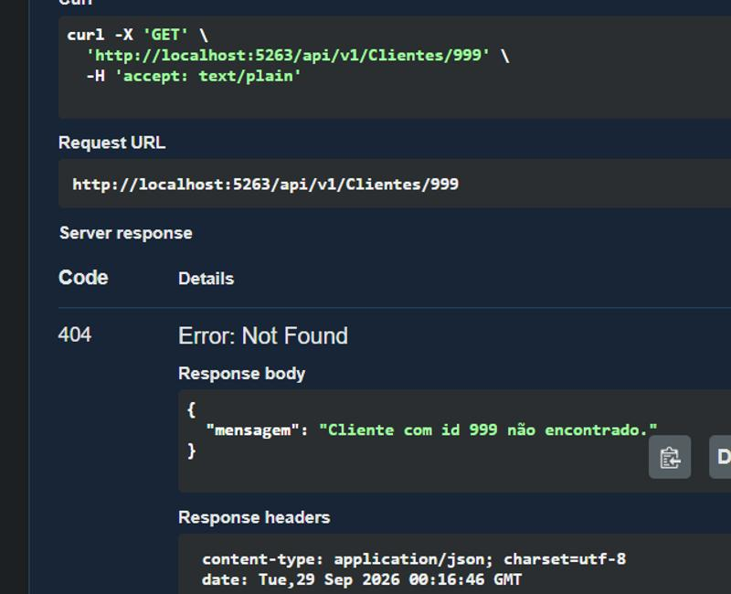 |
| `PUT /api/v1/clientes/{id}` → **204 No Content** | 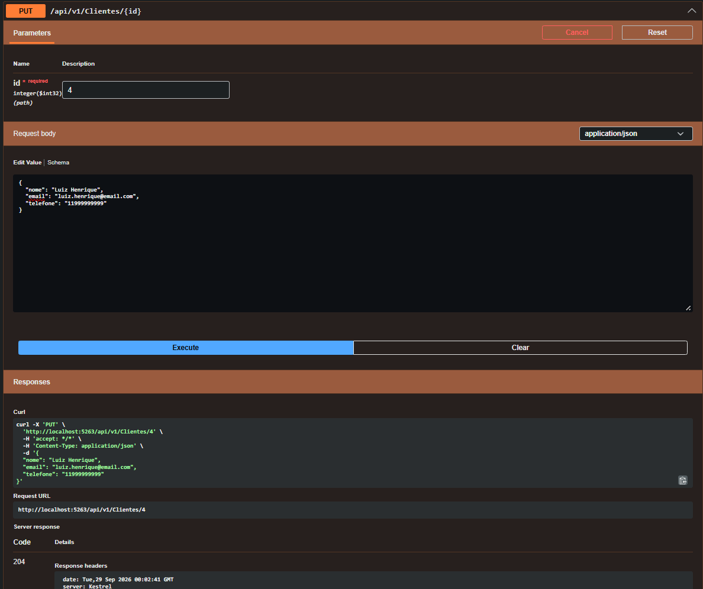 |
| `DELETE /api/v1/clientes/{id}` → **204 No Content** | 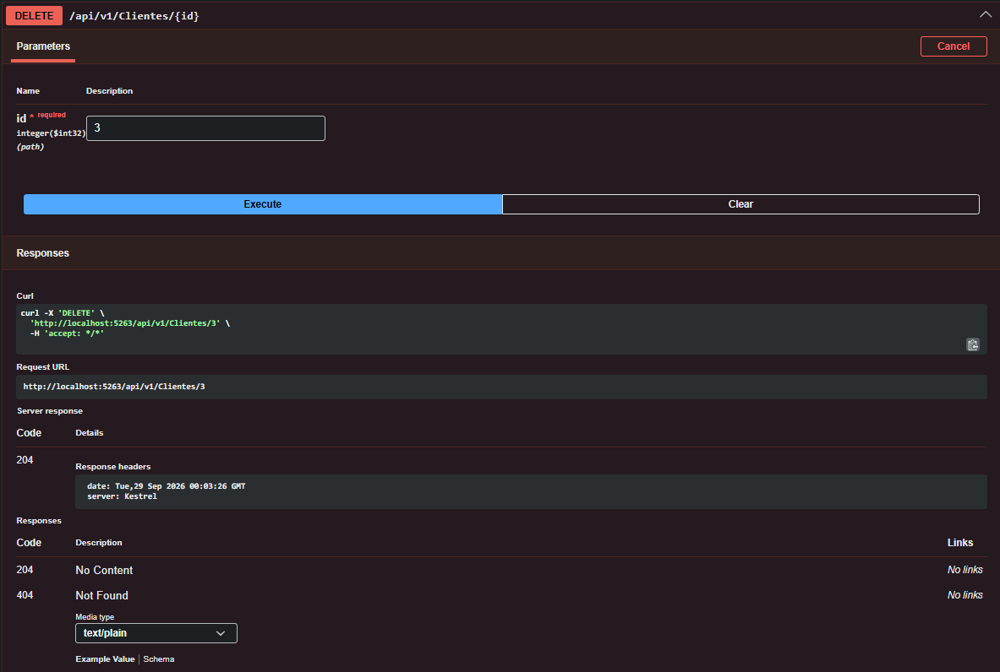 |

### Pedidos

| Endpoint | Print |
|---|---|
| `POST /api/v1/pedidos` → **201 Created** | 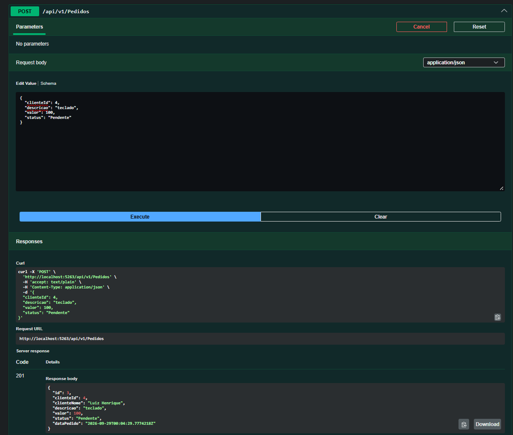 |
| `GET /api/v1/pedidos?status=Pendente` → **200 OK** (filtro por status) | 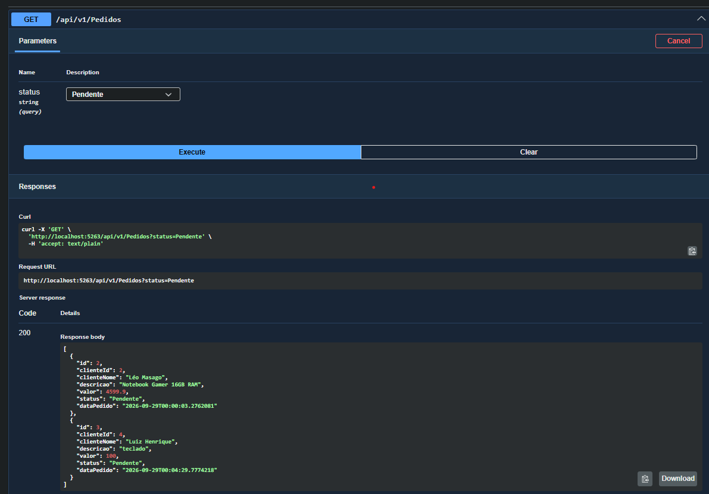 |
| `GET /api/v1/pedidos/{id}` → **200 OK** | 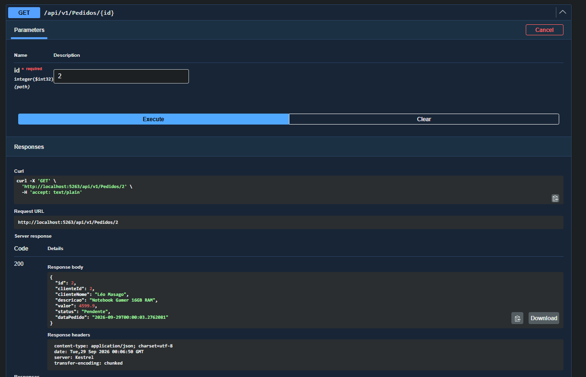 |
| `GET /api/v1/clientes/{id}/pedidos` → **200 OK** (rota aninhada) | 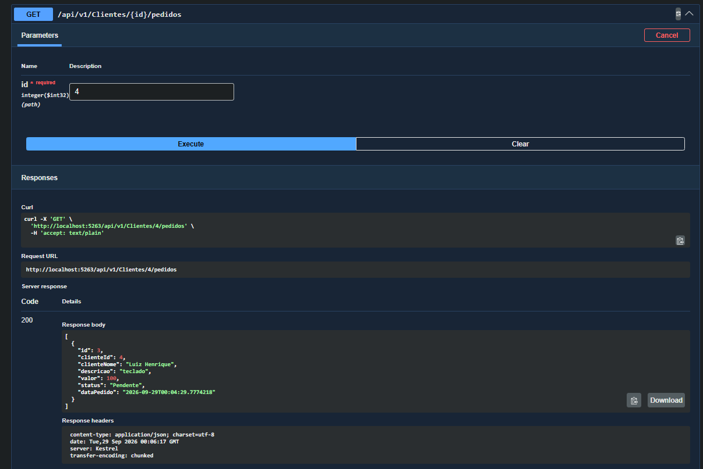 |
| `PUT /api/v1/pedidos/{id}` → **204 No Content** |  |
| `DELETE /api/v1/pedidos/{id}` → **204 No Content** | 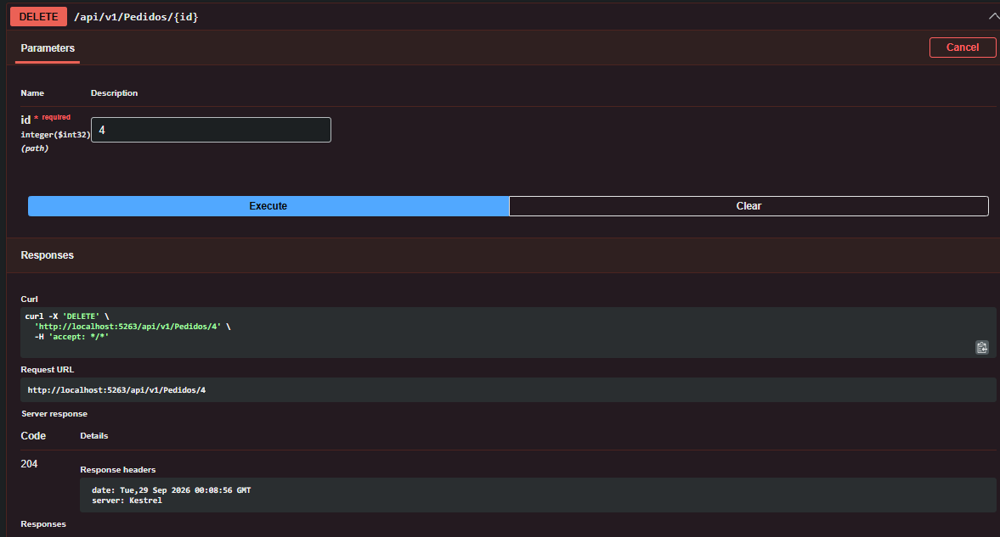 |
